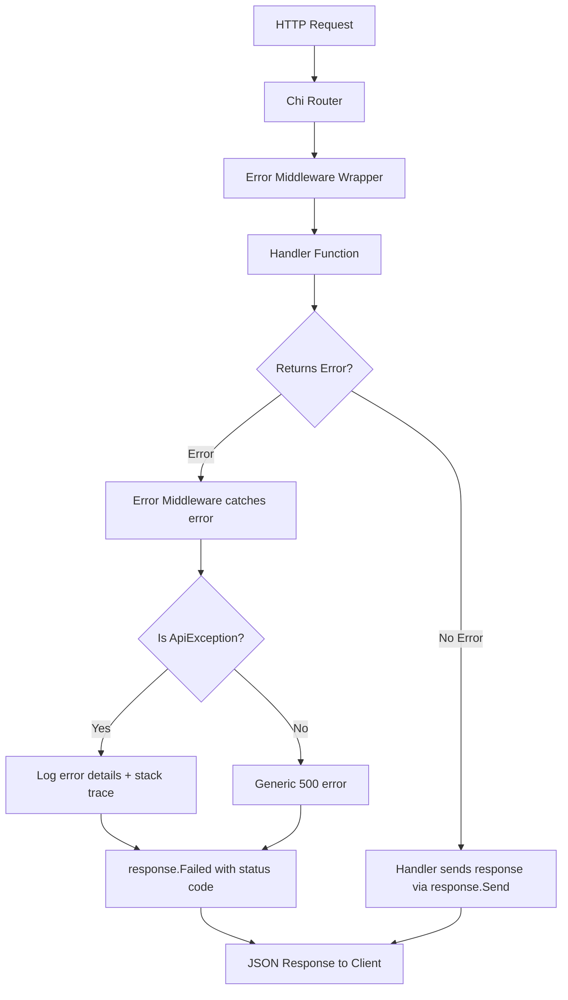
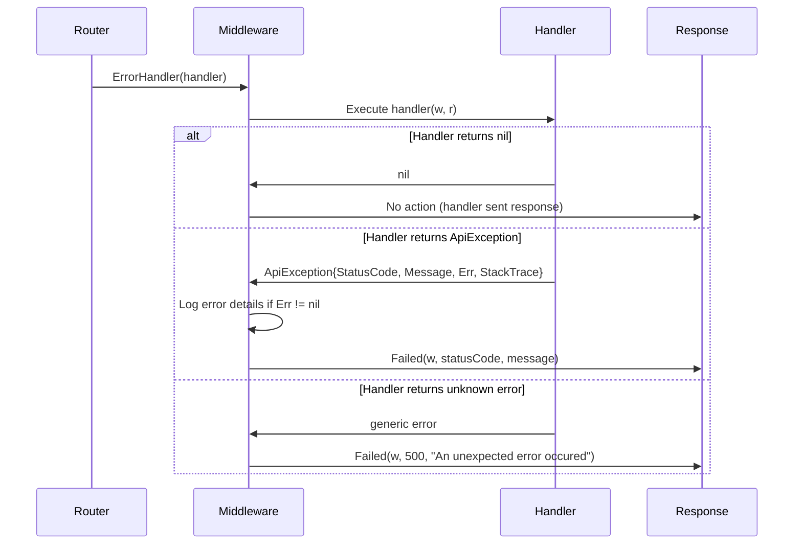

# API Response and Error Handling Architecture

## Overview

This document provides an architectural view of how **API responses**, **API errors**, and **error middleware** work together in your Go application to create a clean, consistent, and maintainable error handling system.

Your application follows the **"Bubble Up" error handling pattern**, which is a best practice in Go web applications. This pattern ensures:
- ✅ Handlers remain clean and focused on business logic
- ✅ Errors are handled centrally in one place
- ✅ Consistent API response format across all endpoints
- ✅ Proper logging and stack traces for debugging
- ✅ Type-safe error handling using Go's `errors.As()`

---

## Architecture Components



---

## Component Breakdown

### 1. **pkg/response/api_response.go** - Response Formatter

**Purpose**: Provides standardized JSON response formatting for all API endpoints.

**Key Functions**:

#### `Send(w http.ResponseWriter, data any)`
Sends a successful response with data:
```json
{
  "status": true,
  "message": "Request completed successfully",
  "data": { ... }
}
```

#### `Successful(w http.ResponseWriter)`
Sends a successful response without data:
```json
{
  "status": true,
  "message": "Request completed successfully",
  "data": null
}
```

#### `Failed(w http.ResponseWriter, statusCode int, message string)`
Sends an error response:
```json
{
  "status": false,
  "message": "error message here",
  "data": null
}
```

**Usage in Handlers**:
```go
// Success with data
response.Send(w, userData)

// Success without data
response.Successful(w)

// Note: Errors are NOT sent directly, they are returned to middleware
```

---

### 2. **pkg/response/api_error.go** - Error Types

**Purpose**: Defines custom error types that carry HTTP status codes and debugging information.

**Key Type**:
```go
type ApiException struct {
    Message    string  // User-facing error message
    StatusCode int     // HTTP status code (400, 404, 500, etc.)
    Err        error   // Original error (for logging)
    StackTrace string  // Stack trace (for debugging)
}
```

**Factory Functions**:

| Function | Status Code | Use Case |
|----------|-------------|----------|
| `BadRequest(msg)` | 400 | Invalid input, validation errors |
| `NotFound(msg)` | 404 | Resource not found |
| `InternalServerError(msg)` | 500 | Unexpected errors (with stack trace) |
| `InternalErrorServerError(msg, err)` | 500 | Wraps underlying error with stack trace |

**Usage in Handlers**:
```go
// Return errors, don't send them directly
if err := json.NewDecoder(r.Body).Decode(&req); err != nil {
    return response.BadRequest("Invalid request body")
}

// Service layer errors bubble up
res, err := h.authService.SignUp(r.Context(), req.Email, req.FullName)
if err != nil {
    return err  // Let middleware handle it
}
```

---

### 3. **internal/middlewares/error_handler.go** - Error Middleware

**Purpose**: Centralized error handling that intercepts errors returned from handlers.

**Key Type**:
```go
type AppHandler func(w http.ResponseWriter, r *http.Request) error
```

This is a **custom handler signature** that returns an `error` instead of the standard `http.HandlerFunc`.

**How It Works**:



**Error Flow**:
1. Handler returns an error
2. Middleware checks if it's an `ApiException` using `errors.As()`
3. If yes: logs details and sends structured error response
4. If no: sends generic 500 error

**Logging**:
```go
if apiErr.Err != nil {
    fmt.Printf("REQUEST FAILED: %s\nReason: %v\nStack Trace:\n%s", 
        apiErr.Message, apiErr.Err, apiErr.StackTrace)
}
```

---

## How They Work Together

### Example Flow: Sign-Up Handler

#### **Handler Code** ([handler.go](file:///d:/repo/gem/internal/services/auth/handler.go#L22-L37))
```go
func (h *AuthHandler) SignUpHandler(w http.ResponseWriter, r *http.Request) error {
    var req SignUpRequest
    
    // Return error instead of sending response
    if err := json.NewDecoder(r.Body).Decode(&req); err != nil {
        return response.BadRequest("Invalid request body")
    }
    
    // Service layer errors bubble up
    res, err := h.authService.SignUp(r.Context(), req.Email, req.FullName)
    if err != nil {
        return err  // Could be ApiException or any error
    }
    
    // Success: send response directly
    response.Send(w, res)
    return nil
}
```

#### **Route Registration** ([route.go](file:///d:/repo/gem/internal/services/auth/route.go#L18))
```go
router.Post("/sign-up", middleware.ErrorHandler(handler.SignUpHandler))
```

The `ErrorHandler` wraps the handler to intercept errors.

---

## Request/Response Flow

### ✅ **Success Case**

```
Client Request
    ↓
Chi Router
    ↓
ErrorHandler Middleware
    ↓
SignUpHandler
    ↓ (no error)
response.Send(w, data)
    ↓
Client receives:
{
  "status": true,
  "message": "Request completed successfully",
  "data": { "user_id": 123 }
}
```

### ❌ **Error Case (Bad Request)**

```
Client Request (invalid JSON)
    ↓
Chi Router
    ↓
ErrorHandler Middleware
    ↓
SignUpHandler
    ↓ (decode error)
return response.BadRequest("Invalid request body")
    ↓
ErrorHandler catches ApiException
    ↓
response.Failed(w, 400, "Invalid request body")
    ↓
Client receives:
{
  "status": false,
  "message": "Invalid request body",
  "data": null
}
```

### ❌ **Error Case (Internal Server Error)**

```
Client Request
    ↓
Chi Router
    ↓
ErrorHandler Middleware
    ↓
SignUpHandler
    ↓
authService.SignUp() returns database error
    ↓
return response.InternalErrorServerError("msg", dbErr)
    ↓
ErrorHandler catches ApiException
    ↓
Logs: "REQUEST FAILED: ... Reason: ... Stack Trace: ..."
    ↓
response.Failed(w, 500, "Internal Server Error")
    ↓
Client receives:
{
  "status": false,
  "message": "Internal Server Error",
  "data": null
}
```

---

## Best Practices

### ✅ **DO**

1. **Return errors from handlers**, don't send responses for errors:
   ```go
   if err != nil {
       return response.BadRequest("error message")
   }
   ```

2. **Use appropriate error types**:
   - `BadRequest()` for validation errors
   - `NotFound()` for missing resources
   - `InternalErrorServerError()` for unexpected errors

3. **Send success responses directly**:
   ```go
   response.Send(w, data)
   return nil
   ```

4. **Wrap handlers with ErrorHandler**:
   ```go
   router.Post("/endpoint", middleware.ErrorHandler(handler.Method))
   ```

### ❌ **DON'T**

1. **Don't send error responses directly in handlers**:
   ```go
   // ❌ Bad
   if err != nil {
       response.Failed(w, 400, "error")
       return nil
   }
   
   // ✅ Good
   if err != nil {
       return response.BadRequest("error")
   }
   ```

2. **Don't mix error handling patterns**:
   ```go
   // ❌ Bad - inconsistent
   if err != nil {
       http.Error(w, "error", 500)  // Don't use http.Error
   }
   ```

---

## Proposed Refinements

> [!NOTE]
> The current architecture is solid. The following are minor naming improvements for consistency.

### 1. **Fix Naming Redundancy in `api_error.go`**

**Current**:
```go
func InternalServerError(msg string) *ApiException {
    return InternalErrorServerError(msg, nil)
}

func InternalErrorServerError(msg string, err error) *ApiException {
    // ...
}
```

**Issue**: `InternalErrorServerError` has redundant "Error" and "Server" words.

**Proposed**:
```go
func InternalServerError(msg string) *ApiException {
    return InternalServerErrorWithErr(msg, nil)
}

func InternalServerErrorWithErr(msg string, err error) *ApiException {
    // ...
}
```

---

## File Structure

```
gem/
├── pkg/
│   └── response/
│       ├── api_response.go    # Response formatting (Send, Successful, Failed)
│       └── api_error.go       # Error types (ApiException, BadRequest, etc.)
├── internal/
│   ├── middlewares/
│   │   └── error_handler.go   # Error middleware (ErrorHandler wrapper)
│   └── services/
│       └── auth/
│           ├── handler.go     # Handlers using error pattern
│           ├── service.go     # Business logic
│           └── route.go       # Route registration with middleware
```

---

## Summary

Your application uses a **clean, idiomatic Go error handling pattern**:

1. **Handlers** return errors instead of sending error responses
2. **ApiException** carries status codes and debugging info
3. **Error Middleware** centrally handles all errors
4. **Response package** provides consistent JSON formatting

This architecture ensures:
- 🎯 **Separation of concerns**: Handlers focus on logic, middleware handles errors
- 🔍 **Better debugging**: Stack traces and error logging in one place
- 🤝 **Consistency**: All endpoints return the same response format
- 🧪 **Testability**: Easy to test handlers by checking returned errors
- 📦 **Maintainability**: Changes to error handling happen in one place
